# Лабораторная работа №3. Облачные сети. Amazon VPC

**ФИО:** Gorbatiuc Evelina  
**Группа:** IA2403  
**Специальность:** Informatică aplicată  
**Номер k:** 18  
**Уровень:** базовый (задания 1–7)  
**Регион:** eu-central-1 (Frankfurt)  
**Owner:** evelina  

---

## Задание 1. План адресов

Составила план IP-адресов для VPC.

**VPC:** `10.18.0.0/16`

| Подсеть   | Зона          | Диапазон       | Доступно |
|-----------|---------------|----------------|----------|
| public-a  | eu-central-1a | 10.18.0.0/24   | 251      |
| public-b  | eu-central-1b | 10.18.1.0/24   | 251      |
| private-a | eu-central-1a | 10.18.10.0/24  | 251      |
| private-b | eu-central-1b | 10.18.11.0/24  | 251      |

**Почему не 256 адресов?**  
AWS занимает 5 адресов в каждой подсети (`.0`, `.1`, `.2`, `.3`, `.255`). Остаётся 251.

**Скриншот**

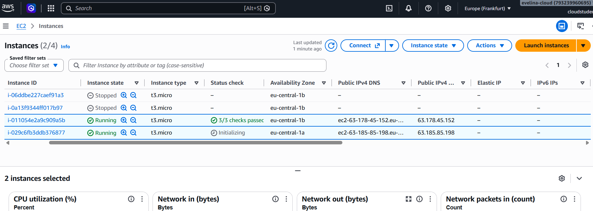

---

## Задание 2. VPC и подсети

Создала VPC `timecapsule-dev-vpc` и 4 подсети по плану из задания 1.

**Является ли public-a публичной?**  
Нет. Подсеть становится публичной только когда в ней есть маршрут в Internet Gateway. Пока его нет — подсеть обычная.

**Скриншот**

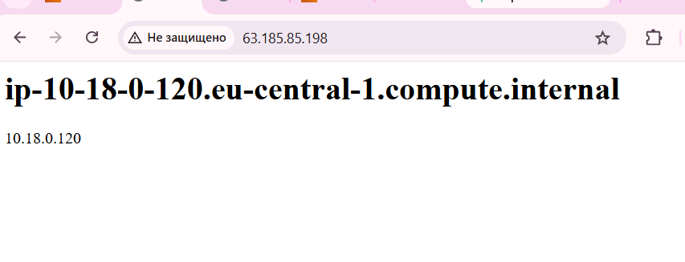

---

## Задание 3. Internet Gateway и таблицы маршрутов

- Создала Internet Gateway и подключила к VPC
- Для публичных подсетей добавила маршрут `0.0.0.0/0 → Internet Gateway`
- Для приватных подсетей маршрута в интернет нет

**Какой маршрут есть в обеих таблицах?**  
`10.18.0.0/16 → local` — он нужен, чтобы серверы внутри VPC могли общаться друг с другом.

**Куда уйдёт пакет из private-a на 8.8.8.8?**  
Никуда. Маршрута в интернет нет, пакет будет отброшен.

**Скриншоты**

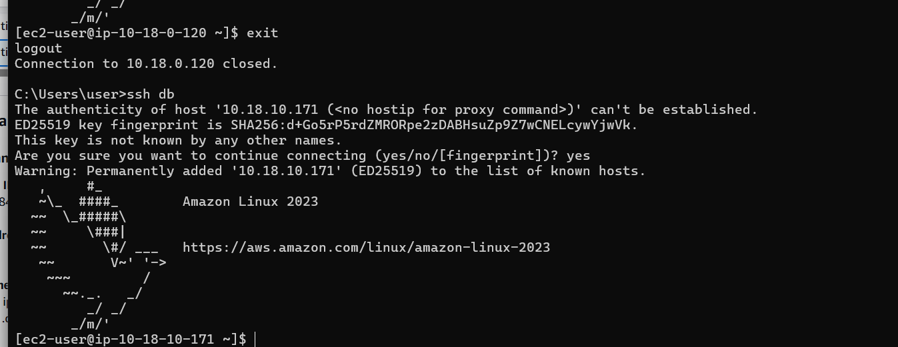

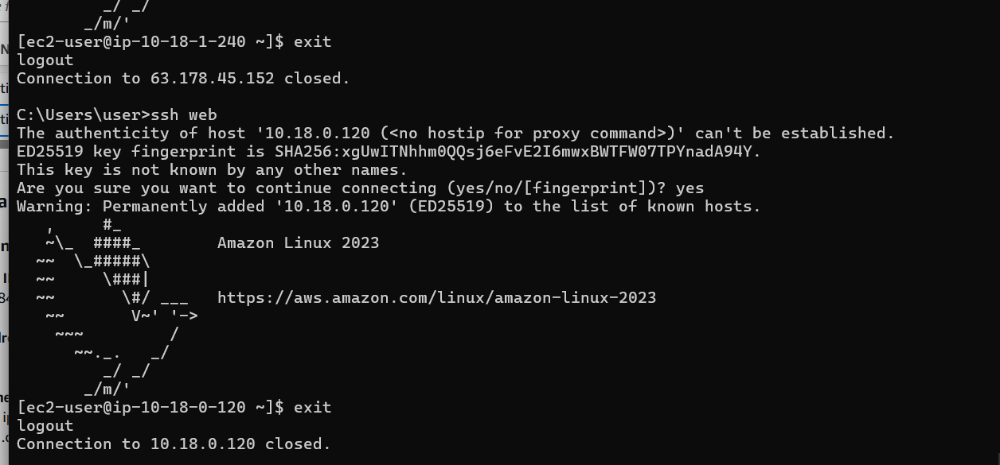

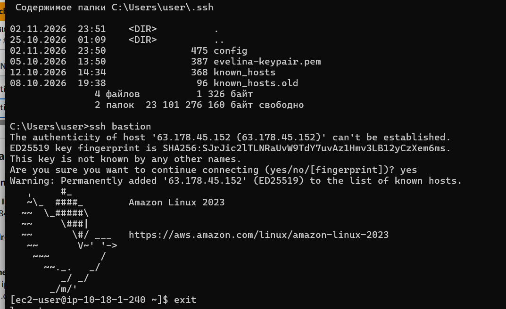

---

## Задание 4. Security Group

Создала 3 группы безопасности:

| Группа     | Что разрешено              | Откуда        |
|------------|----------------------------|---------------|
| bastion-sg | SSH (22)                   | Мой IP        |
| web-sg     | HTTP (80)                  | Все (0.0.0.0/0)|
| web-sg     | SSH (22)                   | bastion-sg    |
| db-sg      | PostgreSQL (5432)          | web-sg        |
| db-sg      | SSH (22)                   | bastion-sg    |

**Почему в db-sg указана группа web-sg, а не IP?**  
IP сервера может измениться. Группа всегда пускает только те серверы, которые в неё входят.

**Скриншоты**

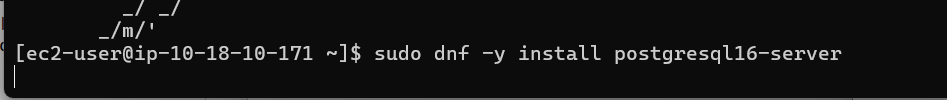

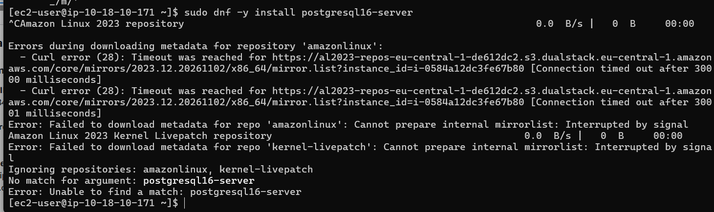

---

## Задание 5. Экземпляры

Запустила 3 сервера:

| Роль       | Имя                    | Подсеть   | Публичный IP |
|------------|------------------------|-----------|--------------|
| bastion    | timecapsule-dev-bastion| public-b  | да           |
| web-server | timecapsule-dev-web    | public-a  | да           |
| db-server  | timecapsule-dev-db     | private-a | нет          |

На web-server через User data поставился nginx.  
SSH на web и db идёт через bastion.

**Почему db-server не может скачать пакеты?**  
У него нет выхода в интернет. Нужен NAT Gateway.

**Скриншоты**

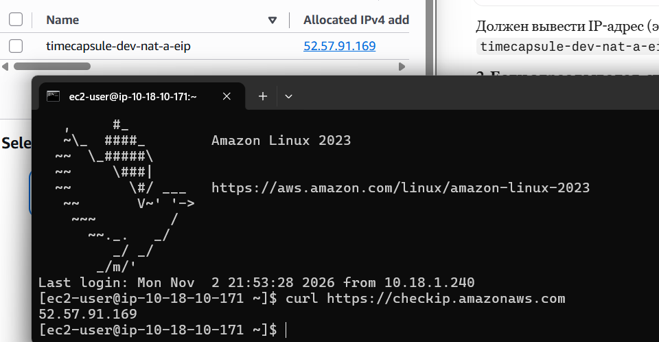

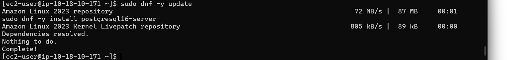

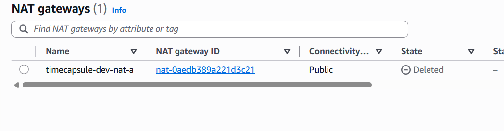

---

## Задание 6. Временный NAT Gateway

Создала NAT Gateway, чтобы db-server мог скачать PostgreSQL.  
После установки PostgreSQL — NAT удалила.

**Какой адрес вернул checkip?**  
Адрес NAT Gateway (не самого db-server). NAT подменяет адрес.

**Три защиты базы:**
1. Нет публичного IP и маршрута в интернет  
2. Security Group пускает только web-sg  
3. PostgreSQL сам проверяет пароль и адрес

**Скриншоты**

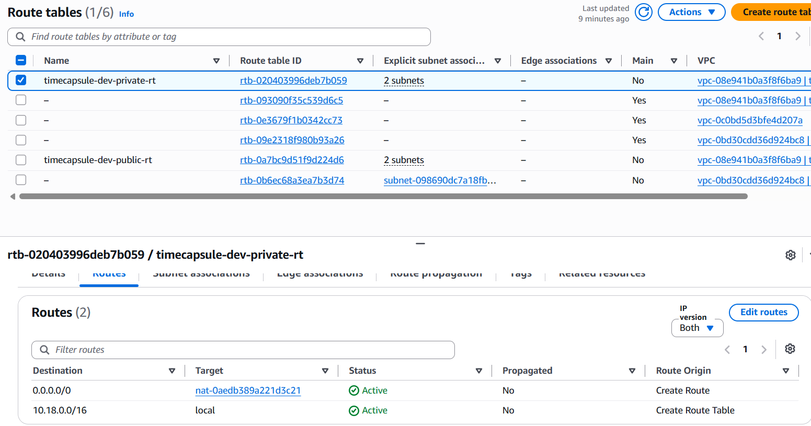

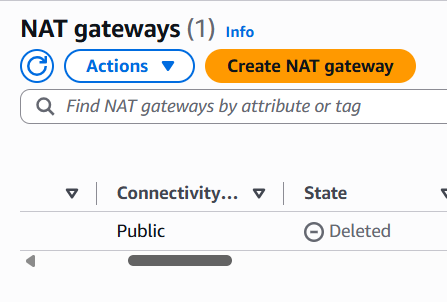

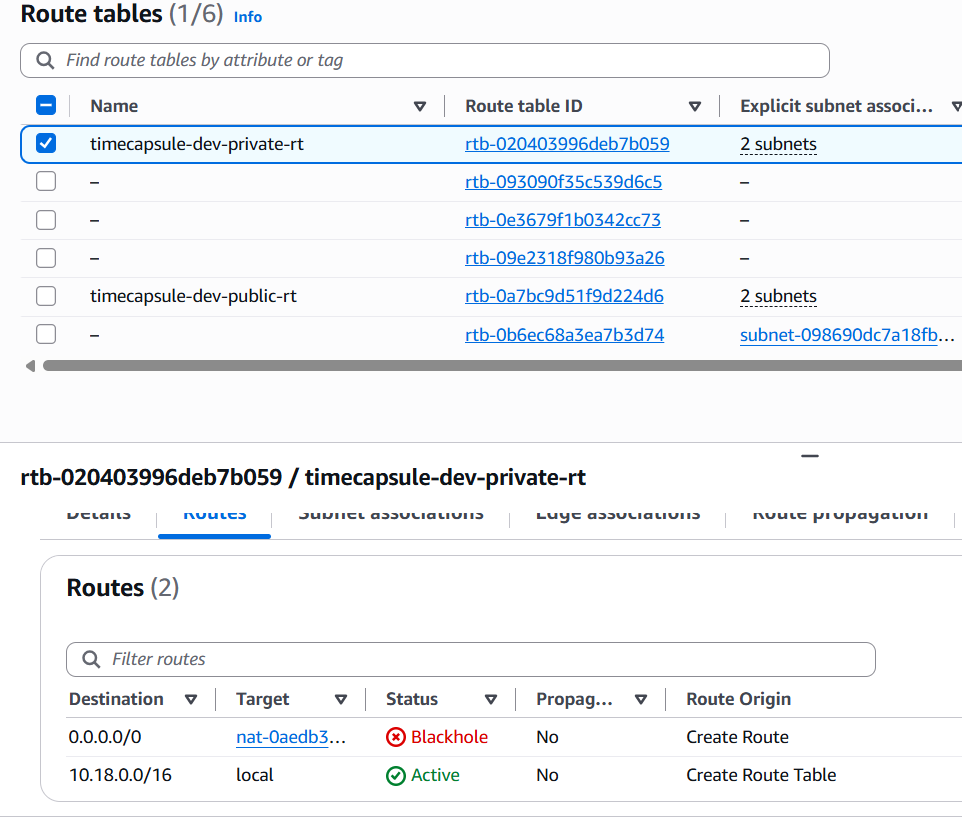

---

## Задание 7. Проверки

**Доступ к базе с web-server** — работает.  
**С bastion** — порт закрыт (Security Group не пускает).  
**Из интернета** — база недоступна.  
**Network ACL** — проверила блокировку по IP.

**Скриншоты**

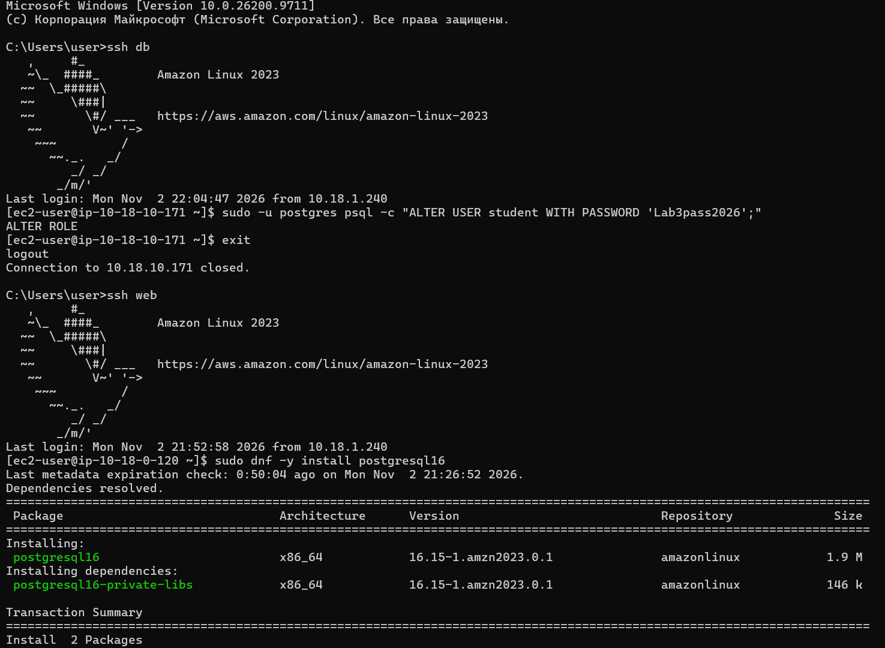

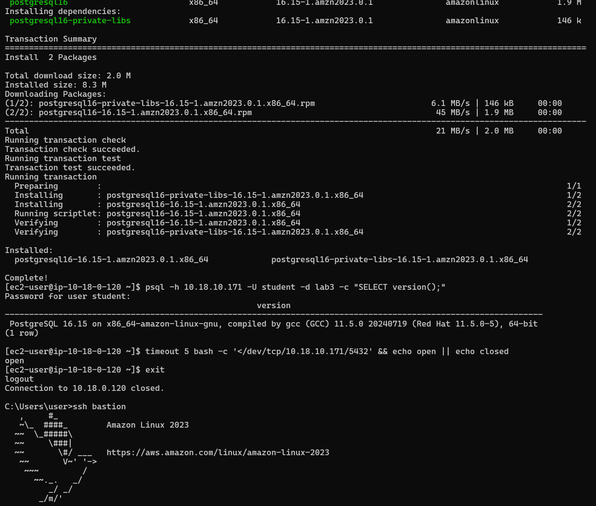

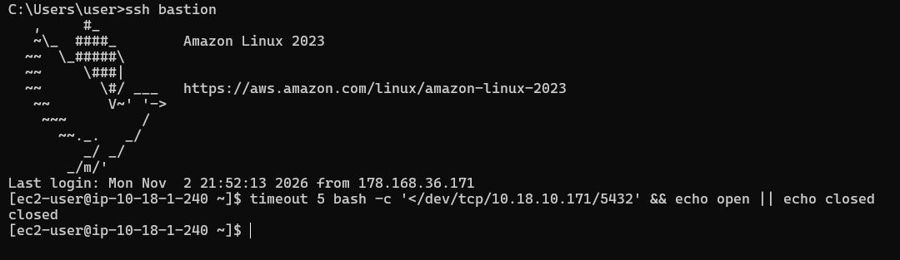

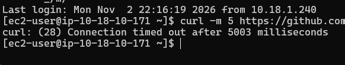

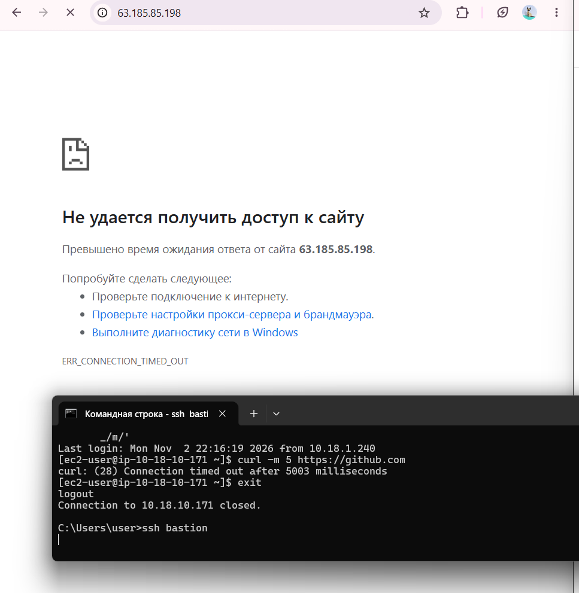

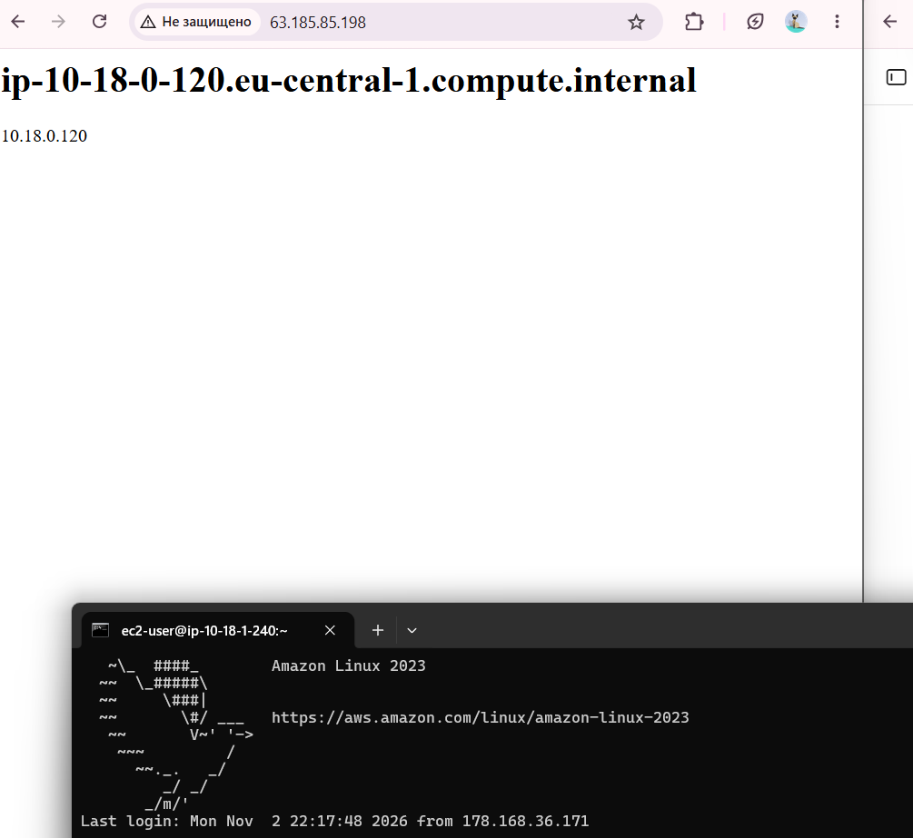

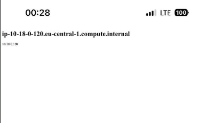

---

## Завершение

Остановила все 3 сервера.  
NAT Gateway удалила.  
VPC и подсети оставила для следующих работ.
